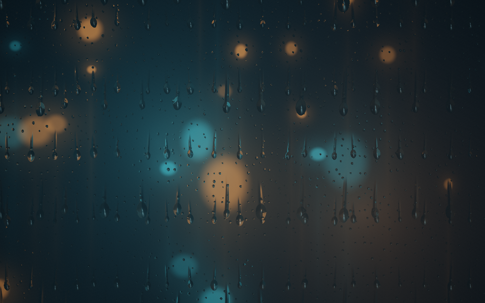

# Rain Window

A WebGL2 rainy-window shader demo using Three.js `ShaderMaterial` on a full-screen plane. A fallback message appears when WebGL 2 is unavailable.

Double-click `index.html` to open it in your browser. An internet connection is required because Three.js loads from a CDN via an import map. No installation or build is needed.

The `proof/` folder contains screenshots.

